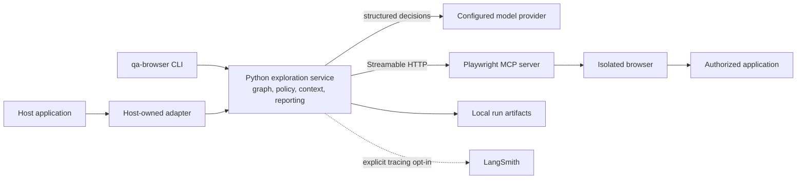
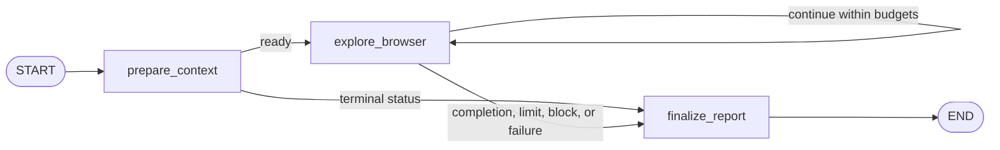
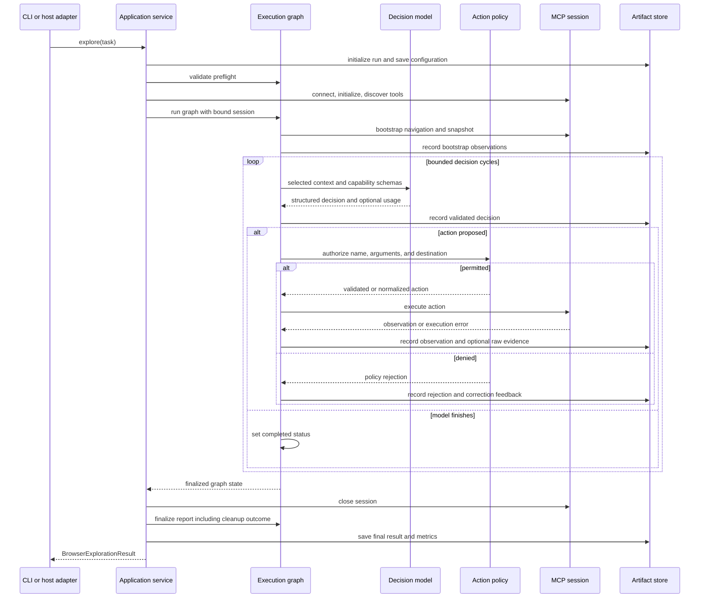

# Browser Exploration Agent — Software Architecture Design

| Document property | Value |
| --- | --- |
| Revision | 1.0 |
| Date | 2026-10-24 |
| System | Browser Exploration Agent |
| Implementation baseline | Package `browser-exploration-agent` 0.1.0; result schema 1.0 |
| Scope | Current architecture, integration boundaries, and explicitly identified future work |

## 1. Purpose and scope

Browser Exploration Agent is a Python capability that explores an authorized web application,
records browser observations, and produces structured QA findings and execution results. It can run
through the `qa-browser` CLI or inside a consuming application's asynchronous workflow.

The system combines model-directed exploration with deterministic execution controls. The model
proposes an action or decides to finish. Application code validates the proposal, enforces the
configured policy and budgets, executes the permitted browser operation, and records the outcome.

This repository owns the browser capability. The consuming application owns requirement analysis,
repository retrieval, its integration adapter, objective assessment, and downstream test design,
generation, and execution. Operators own the target environment and the MCP/browser deployment.

This document explains how the system is constructed and why. The
[V1 integration contract](contracts/browser_exploration_v1.md) defines the detailed public behavior
and consumer obligations. Proposed improvements in Section 14 are not implemented guarantees.

## 2. Architectural requirements

| Requirement | Architectural response |
| --- | --- |
| Reuse from different workflows | Public asynchronous protocol and standalone task/result models |
| Preserve browser continuity | One initialized MCP session for each exploration run |
| Bound autonomous execution | Independent browser-call, model-request, time, and context limits |
| Keep execution authority outside the model | Validated capability catalog and executor-side action policy |
| Produce inspectable results | Structured observations, evidence references, decisions, and metrics |
| Preserve uncertainty and operational failure | Explicit run statuses, finding statuses, and unresolved questions |
| Support offline verification | Injectable model and connection protocols with network-prohibited unit tests |

Python 3.12, Pydantic v2, LangGraph, and Playwright MCP are implementation constraints. The client
does not require the Python Playwright package. The browser is installed and operated on the MCP
host. The current release has no public HTTP server, job queue, shared database, or resume API.

## 3. System context



The CLI and host adapter are alternative entry paths into the same application service. A host
adapter calls Python directly; it does not parse CLI output or depend on internal graph state.

There are two distinct network paths: Python-to-model/MCP traffic and browser-to-application
traffic. Restricting the Python client's requested URLs does not contain the browser's redirects,
scripts, or subresource requests. The operator must enforce the browser network boundary.

## 4. Component design

The implementation uses a small application service, an explicit execution graph, and concrete
adapters for model calls, MCP, and filesystem artifacts. Dependencies are composed at service
construction. Protocols provide replacement points for model and browser test doubles.

| Component | Implementation | Responsibility |
| --- | --- | --- |
| Public contracts | [`contracts.py`](../src/browser_exploration/contracts.py) | Task/result models, nested records, and `BrowserExplorer` protocol |
| CLI and configuration | [`cli.py`](../src/browser_exploration/cli.py), [`config.py`](../src/browser_exploration/config.py) | Parse commands, load CLI configuration, construct tasks, and expose diagnostics |
| Application service | [`explorer.py`](../src/browser_exploration/explorer.py) | Own run initialization, dependency composition, session lifetime, timeout handling, and final persistence |
| Execution graph | [`graph.py`](../src/browser_exploration/graph.py), [`state.py`](../src/browser_exploration/state.py) | Advance the exploration loop, validate outcomes, and maintain run-local state |
| Model adapter | [`model.py`](../src/browser_exploration/model.py), [`prompts.py`](../src/browser_exploration/prompts.py) | Request and validate one structured decision, preserve usage, and sanitize provider errors |
| Context preparation | [`context_builder.py`](../src/browser_exploration/context_builder.py), [`observations.py`](../src/browser_exploration/observations.py) | Select bounded context, compact observations, and preserve mandatory instructions |
| MCP transport | [`mcp_client.py`](../src/browser_exploration/mcp_client.py) | Initialize one session, bind discovered tools, execute calls, and translate transport failures |
| Capability catalog | [`browser_tools.py`](../src/browser_exploration/browser_tools.py) | Recognize supported tool names/schemas and expose restricted argument schemas |
| Action policy | [`safety.py`](../src/browser_exploration/safety.py) | Validate destinations, references, permissions, and tool arguments before execution |
| Artifacts and metrics | [`reporting.py`](../src/browser_exploration/reporting.py), [`telemetry.py`](../src/browser_exploration/telemetry.py) | Write private artifacts, redact recognized secrets, and accumulate measured usage |

`ExplorationNodes` coordinates these collaborators; there is no separate nested agent framework.
The graph's `TypedDict` is an internal execution representation. Pydantic models validate the
application boundary and individual records. The browser core has no dependency on host workflow
models, retrievers, or test runners.

## 5. Public interface and adapter boundary

The application interface is:

```python
from typing import Protocol

from browser_exploration import BrowserExplorationResult, BrowserExplorationTask


class BrowserExplorer(Protocol):
    async def explore(self, task: BrowserExplorationTask) -> BrowserExplorationResult: ...
```

`AutonomousBrowserExplorer` implements the interface. It accepts `Settings` and optional injected
`DecisionModel` and `BrowserConnection` implementations. A connection yields a `BrowserSession`
containing the discovered tool catalog, capability mapping, and asynchronous call interface.

### 5.1 Host-owned mapping

| Host information | Browser input or host record |
| --- | --- |
| Exploration objective | `BrowserExplorationTask.objective` |
| Original requirement | Optional `requirement_text` |
| Retrieved source excerpts | Bounded `ContextSnippet(source, text)` records |
| Approved application and domains | Explicit task URL and exact allowed domains |
| Execution authorization | Permission flags and budgets from trusted configuration |
| Parent identifiers, application/repository version, approvals | Separate host envelope |

The adapter preserves the returned `BrowserExplorationResult` intact. It assesses objective
criteria and applies host continuation or review rules separately. A returned browser result does
not authorize generated-code execution or establish that a requirement passed.

Expected business behavior comes from an approved requirement or domain decision. Browser
observations establish actual behavior and available interactions. The adapter must keep those
sources distinct when assessing findings or designing downstream tests.

The detailed mapping, outcome envelope, and integration-test cases are in
[Adapter-first host integration](adapter_design.md). No host-specific adapter is installed in
this package.

### 5.2 Contract evolution

Public models reject unknown fields. Consequently, adding fields or status values can break an
older consumer even when a change appears additive. Package version, document revision, and result
schema version are separate identifiers. Contract changes require schema review, regenerated JSON
schemas, and producer/consumer compatibility fixtures.

## 6. Execution lifecycle

### 6.1 Run initialization

The service revalidates and copies the task, generates a run ID, creates its artifact store, and
writes the selected run configuration. It initializes fresh graph state and collaborators, then
checks the target, mandatory context, and external network-control attestation before connecting
to MCP.

When preflight succeeds, the service opens an initialized MCP session and discovers supported
tools. Navigation and accessibility snapshot capabilities are mandatory. The session and tools
remain bound for the run. The default model adapter is created lazily when a model decision is
first needed.

### 6.2 Graph structure



### Reading the nodes in code

A graph node is a function that reads and updates the run's shared working dictionary,
[`ExplorationState`](../src/browser_exploration/state.py). There are exactly three graph nodes.
The model, policy, context builder, MCP connection, and artifact store are collaborators used by
those nodes rather than additional graph nodes.

| Node | What happens in one visit | Main code and helpers |
| --- | --- | --- |
| `prepare_context` | Check the target URL, required context size, and network-control attestation; block the run if a prerequisite fails. | [`ExplorationNodes.prepare_context`](../src/browser_exploration/graph.py); `SafetyPolicy.validate_url`, `ContextBuilder.build` |
| `explore_browser` | Check limits, choose one next step, and execute at most one browser call. Repeat while no terminal status is set. | [`ExplorationNodes.explore_browser`](../src/browser_exploration/graph.py); `budget_exhausted`, `next_action`, `execute_action`, `accept_findings` |
| `finalize_report` | Build the result from accumulated evidence, findings, errors, and measured usage. | [`ExplorationNodes.finalize_report`](../src/browser_exploration/graph.py); `TokenAccumulator.counts`, `BrowserExplorationResult` |

Start reading at [`AutonomousBrowserExplorer.explore`](../src/browser_exploration/explorer.py),
which creates state and owns the session lifetime. Then read `build_graph` for node registration
and routing, followed by the three node methods above. Supporting helpers have shorter docstrings;
the main lifecycle and execution methods explain their steps in more detail.

The router uses `status=None` to continue the loop; each action still needs its budget and policy
checks. Any terminal status sends the run to `finalize_report`. Finalization builds a report in
memory; the application service finalizes
again after session cleanup and asks `ArtifactStore.save_result` to write it to disk. Model-selected
`completed` means the loop stopped, while objective assessment remains the host's responsibility.

`prepare_context` repeats the preflight checks inside the observable graph. Each
`explore_browser` invocation performs at most one browser operation or one decision-only cycle.
The initial two cycles navigate and obtain an accessibility snapshot without asking the model.
Both consume browser-call budget.

Later cycles build context, obtain a decision, revalidate it, and either terminate or authorize and
execute one action. An interaction that returns only a snapshot-file link can queue an automatic
snapshot before another model decision. That snapshot consumes a browser call within the same
limits. Every attempted executed action produces an observation when artifact writing succeeds.

### 6.3 Decision and action sequence



The diagram shows the ordinary initialized path. Preflight blocks, exceptions, and interrupted
operations can terminate it earlier. The graph can assemble a report before session exit; the
service finalizes again after cleanup so a session-close failure can change the final outcome.
Persistence and validation failures outside the guarded execution block may raise to the caller.

## 7. State, evidence, and persistence

### 7.1 State ownership

Each run owns its task snapshot, current URL, recent observations, successful-action ledger,
executor feedback, findings, unresolved questions, evidence references, counters, terminal status,
and final result. Policy state tracks observed element references and destinations. A page revision
counter supports duplicate-inspection rejection.

Recent observations and model messages are bounded independently. The complete action ledger,
evidence-reference set, and findings can grow during a run, within the configured iteration/call
limits. Bounded model context is therefore not a fixed bound on total process memory or disk use.

There is no durable graph checkpointer or automatic run resumption. An artifact directory is an
audit record, not a replay-safe checkpoint. Concurrent sharing of mutable settings, injected models,
or browser infrastructure is not a verified isolation mechanism; use run-local dependencies unless
sharing has been separately validated.

### 7.2 Data records

| Record | Role and interpretation |
| --- | --- |
| `BrowserExplorationTask` | Objective, target, optional reference context, permissions, and budgets |
| `BrowserObservation` | Executed action, arguments, URL, bounded summary, time, and error indicator |
| `EvidenceReference` | Observation identity and optional retained payload location |
| `VerifiedBehavior` | Model-reported behavior accepted by successful-evidence-ID checks |
| `BrowserFinding` | Model-reported expected/observed behavior, reproduction, evidence, and classification |
| `ExecutionMetrics` | Measured operation counts, duration, and available provider token usage |
| `BrowserExplorationResult` | Terminal execution outcome and accumulated records |

Valid successful evidence IDs establish provenance; they do not prove that a description follows
from the observation. The runtime downgrades findings with unsupported evidence references or
missing required reproduction steps, but does not independently evaluate semantic correctness.
Screenshot pixels never enter the decision model, so screenshot-only claims cannot establish
visual correctness.

### 7.3 Artifact layout

```text
<output_dir>/<run_id>/
  run_config.json       selected configuration, excluding credentials
  trajectory.jsonl      observation summaries and redacted action metadata
  decisions.jsonl       recorded decisions, rejections, and model errors, when present
  result.json           BrowserExplorationResult, schema_version 1.0
  metrics.json          ExecutionMetrics
  evidence/             optional retained text and binary payloads
```

Artifacts are written with private permissions and selected path/symlink protections. Raw evidence
retention defaults to false. Disabling raw retention still leaves bounded summaries and metadata
in the trajectory. `retained=false` does not promise that an original payload can be reconstructed.

The local store has no implemented retention scheduler, global quota, or transaction across files.
Storage failure can leave partial artifacts. The host controls output-root access, artifact
resolution, retention, and cleanup. Server-side browser profiles and MCP files have a separate
lifecycle.

## 8. Model context and decision design

Each request uses freshly selected messages rather than an ever-growing conversation transcript.
Mandatory system instructions, the complete objective, restrictions, and current URL take
priority. Executor feedback and a selected successful-action summary precede recent observations;
findings, questions, requirement text, and supplementary snippets follow as space permits.

The context builder selects the newest observations first and includes only a recent portion of
the action ledger. Snapshot compaction reduces verbose link query content before deterministic
truncation. Truncation is explicit and can omit useful information. There is no semantic summarizer
or guarantee that every supplied snippet reaches the model.

The model adapter requests exactly one action or completion through structured output. Pydantic
revalidates the decision, including injected test decisions. Dynamic action arguments are validated
again by the executor. Provider configuration errors and request failures produce sanitized
diagnostics; the adapter does not automatically select another model.

The model receives text, not screenshot pixels. Tool schemas are appended under a separate
32,000-character limit. Character limits are not token limits, and the tool catalog is additional
to the selected-message budget.

## 9. Failure, completion, and recovery

Run termination, finding verification, and host workflow disposition are separate concepts.

| Run status | Meaning | Integration consequence |
| --- | --- | --- |
| `completed` | The model chose to finish the loop | Host assesses objective criteria and evidence before advancing |
| `step_limit` | Browser-call budget exhausted | Preserve partial observations and unmet/unknown criteria |
| `model_limit` | Model-request budget exhausted | Preserve partial work without silently increasing budget |
| `timeout` | Run or tool deadline reached | Remote action outcome may be unknown |
| `cancelled` | Cancellation caught during guarded execution | Stop dependent work and preserve cancellation |
| `blocked` | Policy, context, or observed destination prevented progress | Report the unmet prerequisite or denied operation |
| `failed` | Guarded model, transport, browser, or execution failure | Treat as an exploration/dependency failure, not a product assertion verdict |

Finding statuses are separately `confirmed`, `potential`, and `inconclusive`. A normal function
return, `completed` status, or a `confirmed` finding is not an independent proof that a user
requirement passed. The host owns that assessment.

Malformed decisions may receive up to two consecutive correction requests, using the existing
time and iteration budgets. Policy-rejected model proposals return feedback without executing
the action. Duplicate inspections are rejected until a tracked interaction changes page revision.
There is no additional no-progress termination threshold.

The client does not automatically reconnect or replay a browser operation after a disconnect or
unknown outcome. Remote rollback and exactly-once execution are not provided. The async service
converts caught cancellation into a `cancelled` result; callers must inspect that returned status.

Task revalidation, artifact initialization/config writes, and final persistence can raise outside
the guarded run. The adapter needs its own validation/storage exception boundary and must not
invent a successful node result when no valid result was returned.

## 10. Deployment and configuration

### 10.1 Deployment units

| Unit | Deployment and lifecycle |
| --- | --- |
| Python client | Dedicated Python environment containing this package; launched by CLI or host process |
| Model endpoint | Configured external dependency with account-specific credentials and availability |
| Playwright MCP | Independently started server with compatible tools and an installed browser |
| Browser and target | Controlled context and authorized application with externally enforced access restrictions |
| Artifact directory | Local filesystem location writable by the client and governed by the operator |
| LangSmith | Optional tracing dependency enabled only for approved data |

MCP transport is Streamable HTTP. Plain HTTP is accepted for loopback endpoints; non-loopback
endpoints require HTTPS. The package does not provision remote authentication, reverse proxies,
network controls, or browsers. Python Playwright installation is not a prerequisite for the client.

The [Compose example](../examples/browser_exploration/compose.yaml) couples MCP and a static fixture
through an internal Docker network and shared network namespace. It is a controlled transport demo,
not a hardened production deployment. Its image tags require a deployment-specific pinning decision,
and its browser sandbox exception should not be copied into a general deployment without review.

### 10.2 Configuration ownership

`Settings` contains model/transport/storage options, external-network attestations, tool timeout,
tracing, and task-budget defaults. `BrowserExplorationTask` contains the actual run budgets and
permissions. The CLI explicitly maps settings defaults into a task; direct Python callers must
perform that mapping when desired.

The CLI loads `.env` without overriding exported variables. Direct Python construction does not
automatically load `.env`. Explicit CLI model selection takes precedence over environment model
selection. Model API mode and reasoning options are deployment configuration, not promises of
provider availability.

| Resource limit | Default | Accounting |
| --- | --- | --- |
| Browser calls, `max_steps` | 30 | Includes navigation, initial snapshot, and automatic snapshots |
| Model requests, `max_model_iterations` | 20 | Includes correction requests |
| Run budget, `max_duration_seconds` | 120 seconds | Cooperative async execution; not a process-kill guarantee |
| Individual tool timeout | 20 seconds | Each browser operation |
| Recent observations | 5 | Candidates selected for each decision |
| Observation characters | 6,000 | Bounded summaries/context entries |
| Selected-message characters | 18,000 | Includes system/objective/restrictions; excludes separate tool catalog |

The run budget does not enclose every artifact initialization/final-write operation. There is no
hard dollar budget, exact token cap, disk quota, or configured maximum concurrent-run count.
Throughput depends on model latency, browser latency, target complexity, and operator-provisioned
capacity; the project defines no availability or throughput SLA.

## 11. Security and data handling

Trusted configuration supplies destinations, budgets, permissions, and storage policy. Page data,
retrieved snippets, model output, and server descriptions cannot expand that authority. Prompt
instructions are supplemented by executor checks.

The tool catalog accepts exact supported aliases and compatible schemas. Navigation and snapshots
are mandatory; hover, clicks, input, form filling, screenshots, console, and network inspection are
optional. Arbitrary JavaScript, file uploads, and credential-management tools are excluded.

Generic clicks, input, and submission are disabled by default and have separate authorization
flags. Known sensitive/authentication, payment, destructive, and publishing controls remain denied.
Observed links can be converted to validated URL navigation. References must match observed
elements; CSS/XPath or label guesses are not used to resolve targets.

Client URL checks validate exact hosts, schemes, credentials, recognizable private destinations,
and metadata endpoints. They do not enforce all ports/routes, resolve DNS, prevent rebinding, or
stop redirected/subresource requests before those requests occur. Label/route classification is
heuristic and incomplete, including across languages.

`network_restricted=true` is an operator attestation, not an installed firewall. Private network
access has its own explicit opt-in. A dedicated MCP deployment and controlled application are
prerequisites for the intended operating model.

Redaction handles recognized patterns and URL query values. It cannot identify all sensitive text
or redact screenshot pixels. Raw evidence and tracing default to disabled; any enablement requires
approved data and operator-defined retention. Model-provider and MCP-server data handling remain
external responsibilities.

## 12. Operations and verification

The CLI exposes four independent operations:

| Command | External interaction and result |
| --- | --- |
| `qa-browser check` | Initializes MCP and validates discovered capabilities; no model request or exploration |
| `qa-browser check-model` | Makes one bounded structured model request; no browser connection |
| `qa-browser run` | Runs exploration and reports its status and artifact path |
| `qa-browser schemas` | Exports public JSON schemas without external services |

Structured logs identify runs, selected model configuration, browser actions, and rejection
reasons. Provider model metadata is retained when available. Metrics distinguish attempted,
successful, and failed browser calls and count model requests. Missing provider token usage remains
`null`; it is not estimated. These counters do not measure functional application coverage.

The verification layers are:

| Layer | What it establishes |
| --- | --- |
| Offline unit tests | Contracts, policy, context selection, budgets, state transitions, errors, and artifacts using injected fakes |
| Package-boundary tests | No host imports, independent public import, and schema/package boundaries |
| Opt-in local MCP test | Persistent-session navigation and snapshots against the bundled fixture |
| Live model/application evaluation | Needed separately to measure objective fulfillment and supported findings |

Default CI installs the lock, runs Ruff lint/format, mypy, parallel unit tests, and builds the
package. Live services remain opt-in. The optional `tests.sandbox_polling` plugin addresses the
documented restricted-sandbox selector issue only in the test process. It is not runtime behavior.

Architecture acceptance requires preserving the public boundary, all terminal states, policy
rejection before execution, bounded decisions, and artifact provenance. Quality evaluation also
needs approved objective criteria, versioned fixtures, and known-defect cases. Historical test
counts and extraction results are recorded in [the extraction report](extraction.md); this document
does not claim a new live validation run.

## 13. Architectural decisions and tradeoffs

| Decision | Rationale | Consequence |
| --- | --- | --- |
| Standalone package with host-owned adapters | Keep the browser capability reusable across workflows | Consumers own domain mappings, lineage, approval, and continuation rules |
| Async protocol as the public interface | Match network-bound execution and support injected implementations | A remote service requires a separate transport contract |
| One explicit LangGraph per run | Make state transitions, budgets, and termination inspectable | The graph/coordinator currently owns several execution concerns |
| One MCP session for the run | Preserve browser continuity and session-bound tool bindings | Disconnect ends reliable continuity; reconnect is not transparent recovery |
| Executor validates every model action | Keep authorization independent of model instructions | Rejected proposals consume model/time budget and may reduce task progress |
| Fresh bounded context with an action ledger | Control request growth while retaining selected progress | Truncation can omit relevant evidence; the full run state still grows |
| Local JSON/JSONL artifacts | Provide inspectable results with a small operational footprint | No transactional persistence, cross-host artifact service, or retention scheduler |
| Explicit uncertainty and no automatic browser replay | Preserve honest outcomes when remote state is unknown | Host/operator intervention may be needed after partial execution |

These choices describe the implementation. They do not imply approval of a particular production
deployment or a commitment to unimplemented extensions.

## 14. Limitations and evolution

The following are proposed directions, not current capabilities:

| Priority | Design issue | Proposed direction and compatibility impact |
| --- | --- | --- |
| First | Model completion does not establish objective fulfillment | Define host-owned objective criteria and evidence assessment; preserve V1 run status |
| First | Evidence-ID validity does not establish semantic support | Evaluate claim relevance/chronology on reviewed and known-defect fixtures before adding stronger verification claims |
| Next | Screenshot capture and visual verification are conflated in reporting | Design executor-owned capture records; review schema compatibility before changing result fields |
| Next | Artifact failures can escape the structured result boundary | Define an explicit persistence-failure contract and failure-injection tests |
| Next | Repeated rejected proposals can consume all iterations | Evaluate a bounded no-progress rule with recorded trajectories |
| Before scale-out | Sharing and workload capacity are unspecified | Validate run-local dependencies, browser allocation, admission limits, and storage ownership before adding workers |

Open deployment decisions include the first controlled application/version, allowed interaction
policy, evidence retention, approved model configuration, and measurable quality/cost/latency
thresholds. These belong to the consuming system and deployment plan. Credentials, authentication
flows, broader mutation support, vision, and remote scheduling require separate scope and contract
decisions.

## 15. Documentation and source references

- [V1 integration contract](contracts/browser_exploration_v1.md): public schemas, operational semantics, and consumer obligations.
- [Adapter design](adapter_design.md): host mappings, envelope, routing, and contract-test scenarios.
- [Operating guide](browser_exploration/README.md): installation, commands, and controlled demo setup.
- [Implementation architecture notes](browser_exploration/architecture.md): detailed module behavior.
- [Boundary investigation](browser_exploration/boundary_review.md): inspected capability limits and extraction decisions.
- [Plan review findings](plan_review_findings.md): unresolved correctness and delivery risks.
- [Reusable contract template](templates/node_contract_template.md): a starting point for another node's public contract.

The source of truth for current behavior is `src/browser_exploration/`; public field definitions
and generated schemas govern serialization. Keep this design, implementation notes, and the
integration contract aligned when changing a boundary or runtime responsibility.
