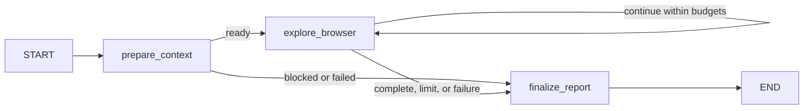

# Browser exploration architecture

The [system architecture design](../architecture.md) is the primary design document for the
standalone package. These notes provide additional implementation detail for its components.

The package lives at `src/browser_exploration/`. It is a standalone capability with Pydantic v2
contracts and an asynchronous `BrowserExplorer` Protocol. Host workflow state, requirement
analysis, retrieval, and evaluation datasets belong to consuming applications. There is no
host adapter or workflow integration installed in V1.

## Orchestration

One explicit LangGraph `StateGraph` owns execution:

The application service initializes the run state. `prepare_context` validates deployment
restrictions and the target. `explore_browser` performs one bounded cycle: select
context, request a structured model decision when needed, validate the action, invoke one
browser tool, and record its observation. Initial navigation and an accessibility snapshot are
deterministic setup and consume two browser calls; the model chooses subsequent interactions
and when it has sufficient evidence. An interaction response containing only a snapshot-file link
queues a fresh accessibility snapshot before the next model decision, within the same budgets.
`finalize_report`
assembles the result without an additional unconstrained reporting conversation.

There is no nested ReAct agent or second state machine. No deprecated
`langgraph.prebuilt.create_react_agent` is used. The model cannot edit limits or policy. Browser
calls, model calls, and wall-clock time independently bound execution. A final model decision
can report completion; reaching any limit produces its explicit partial status. The outer
runner records timeout/cancellation even if graph execution was interrupted before finalization.

Graph state uses a `TypedDict` holding task, current URL, selected messages, recent observations,
a compact successful-action ledger, latest executor feedback, verified behaviors, unresolved
questions, findings, evidence
references, counters, bootstrap stage, status, errors, and the final result. Pydantic validates
boundary records rather than replacing LangGraph's internal state mechanism.

## Components

| Component | Responsibility |
| --- | --- |
| `contracts.py` | Versioned task/result and evidence/finding contracts; explorer Protocol |
| `config.py` | Independent environment settings and endpoint validation |
| `graph.py`, `explorer.py` | Explicit graph, lifetime, limits, terminal status, composition |
| `model.py`, `prompts.py` | ChatOpenAI structured decisions and authoritative restrictions |
| `context_builder.py` | Deterministic selection and character limits |
| `observations.py` | Snapshot query compaction and explicit bounded truncation |
| `mcp_client.py` | Persistent initialized Streamable HTTP session and connection diagnostics |
| `browser_tools.py` | Capability discovery, filtering, and tool argument schemas |
| `safety.py` | URL/action restrictions and observed link/reference interpretation |
| `state.py` | Run-local LangGraph `TypedDict` state |
| `reporting.py`, `telemetry.py` | Safe artifacts, evidence references, actual measured counters |
| `cli.py` | MCP `check`, browser-free `check-model`, `run`, and JSON schema export |

Components accept injected fakes for offline tests. Browser execution always goes through MCP.
The standalone client has no Python Playwright dependency; the operator provisions the compatible
browser on the MCP host.

## Persistent MCP boundary

`MultiServerMCPClient` is configured with a `streamable_http` connection to the validated
endpoint. Entering `client.session(...)` initializes one `ClientSession`; `load_mcp_tools`
discovers tools bound to that session. Tool calls reuse those bindings until the run exits,
including navigation followed by observations. Context-manager exit closes the connection.
The separate `check` command uses the same connection/discovery path without constructing an
LLM or needing its credentials.

Known capability aliases and validated schemas map dynamically discovered names to supported
operations. Mandatory navigation and snapshot capabilities must be present. Optional tools,
including typing and form filling, are only offered if their capability is recognized. Unknown,
arbitrary-code, file-upload, and unrestricted tools stay outside the model catalog. Form targets
must come from the latest snapshot and require explicit input/submission permissions. Version
incompatibility fails explicitly.

Session disconnect and navigation/tool failures produce diagnostic errors and incomplete
statuses. Potentially state-changing operations are never automatically replayed. A lost
session cannot be assumed to preserve the browser's previous state.

## Contracts and evidence

`BrowserExplorationTask` contains URL, objective, optional requirement text and typed source/text
context snippets, exact allowed domains, mutation authorization, and execution/context budgets.
The service makes a validated task copy so caller edits cannot change a running task, and the
decision schema has no budget fields. Unknown fields are rejected. URL validation happens before
any browser action.

`BrowserObservation` contains an ID, URL, action name and redacted arguments, bounded summary,
optional raw evidence reference, UTC timestamp, and error indicator. Observations are written
to `trajectory.jsonl`; only a configured recent subset is selected for model context.

`BrowserFinding` contains its ID, title, description, expected/observed behavior, reproduction
steps, evidence IDs, verification status, optional severity, and optional confidence. Status
`confirmed` requires evidence from successful textual observations and reproduction steps;
unknown or failed references downgrade the finding to `inconclusive`. The model cannot use a
screenshot placeholder alone as confirmation because no pixels are sent to the model.
`potential` communicates a hypothesis; `inconclusive` communicates an
observation that cannot establish expected behavior. `VerifiedBehavior` separately records
successful observable checks with evidence IDs.

`BrowserExplorationResult` has schema version `1.0`, run ID, objective/target, real terminal
status, start/finish times, all reported records, metrics, observed action names, and structured
errors. `EvidenceReference` links an observation to a kind, relative artifact path when retained,
and a retention flag. `ExecutionMetrics` records measured provider tokens or `null`, never
estimated tokens or functional coverage. JSON schemas generated by `qa-browser schemas`
are the authoritative field/type reference; additive or breaking changes require version review.

## Context selection and trust

For each model decision, the context builder creates a fresh system/human message pair. It
prioritizes objective and authoritative restrictions, current location, latest executor feedback,
successful-action progress, recent observations (newest first), completed checks and findings, unresolved
questions, then requirement and supplementary snippets. The trusted progress ledger retains a
bounded set of redacted action arguments, URLs, and evidence identifiers so completed objective
steps remain visible after their observations leave the recent window. Recent count, observation
text size, and total message character limits are configurable. Tool schemas are separately bounded
by the model adapter to 32,000 characters; that catalog is additional to the configured
context-message budget.
The complete objective and authoritative restrictions must fit that message budget. Oversized
objectives produce `blocked` with `context_limit` before connecting to MCP; instructions are
never truncated to make room for observations.

Full raw snapshots and screenshots remain outside message history. Truncation is deterministic and
explicit; no summarizer or semantic compression is claimed. Full retained payloads remain
available to a reviewer through artifact references when retention was enabled. Truncation can
omit useful details, so insufficient information becomes an unresolved question or partial run.

Webpage/tool text and supplied reference snippets are untrusted data. The system prompt instructs
the model to ignore embedded instructions; application policy independently validates selected
tools and destinations. Prompt instructions alone cannot enforce authorization. A denied model
proposal is recorded as unresolved context and returned to the bounded decision loop without
execution. Successful snapshots, screenshots, console reads, and network reads are keyed to the
current page revision; identical inspections are rejected until an interaction changes that
revision. Bootstrap policy failures and unsafe states observed after execution remain terminal.
Reference formatting wrappers are normalized only against exact observed references. Selectors
are never resolved heuristically to an element; all normal label and permission checks still apply.
External browser egress controls are required because observing a redirect after it occurs cannot
prevent the redirected request, DNS can change, and page scripts can make requests outside the
visible URL.

## Retention and observability

Every run has its own output directory. The trajectory retains bounded summaries and redacted
arguments; optional separate raw evidence files retain supporting text/images. Binary data is
not written inside result JSON or model context. Client retention does not manage server-side
artifacts. Pattern redaction is best effort and screenshots may contain secrets, so deployment
must use authorized, sanitized test data.

`run_config.json` stores an explicit allowlist of model/task configuration for later comparisons.
It distinguishes the configured model from an injected adapter. `decisions.jsonl` retains each
validated model decision and each rejection with its iteration and reason, using private file
permissions and the same redaction as other artifacts. Repeated rejected proposals remain visible
even though the final unresolved-question list is deduplicated.

Model validation errors record only safe schema paths/types and available provider model metadata.
The graph permits two consecutive correction requests within the task's model/time limits; no
browser operation is replayed. A successful decision resets that counter. API/configuration errors
remain terminal. Explicit `--model` selection takes precedence over environment settings and is
shown in startup/final CLI output.

Provider request failures preserve allowlisted HTTP status/code/parameter metadata, including
underlying exceptions wrapped by the model client. Raw provider messages, request bodies, headers,
and unknown metadata are omitted. `check-model` exercises the same structured decision adapter
with one small public prompt and a bounded deadline, without starting a browser or falling back
to a different model.

Snapshot summaries remove verbose link query strings when over budget before truncating the
remaining text. Reference validation uses the original observed snapshot, and separately retained
raw evidence keeps the full redacted snapshot. Screenshot pixels remain outside model context.

Counters distinguish attempted browser/model calls and successful/failed browser calls. Provider
usage metadata supplies token counts when available. Structured failures preserve the real
execution outcome. Optional LangSmith traces require explicit configuration and may contain
selected application content. No TinyFish integration, evaluation coverage metric, generated
test code, POM changes, or external test-management integration is included.
